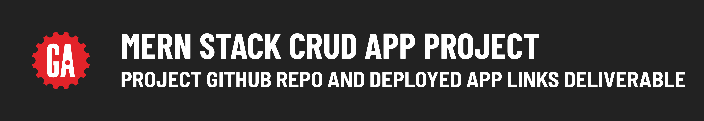

# 

## Contents

**Deliverable details**:

- GitHub repo deliverables
- Deployed app link deliverable

**Submitting deliverables**:

- Submitting your deliverables

## GitHub repo deliverables

After your project proposal has been approved, you will need to set up two GitHub repos - one for the front-end of your project and another for the back-end of your project.

> 🚨 As a reminder, you should use the same repo or keep all the repos you use for the entire duration of your project to meet the project requirements.

## Deployed app deliverable

During project week, you'll deploy your project so that others are able to use it on the internet! Follow the [tktk Deployment guide](https://pages.git.generalassemb.ly/modular-curriculum-all-courses/universal-resources/deployment/tktk/) to deploy your project.

## Submitting your deliverables

Follow the guidelines below to submit your deliverables for this project.

### Submitting your GitHub repo link

Submit a link to the ***public*** GitHub repos that you are using for the front-end and back-end of your MERN Stack CRUD App Project below in the following format:

```plaintext
Front-end GitHub repo link: <link>
Back-end GitHub repo link: <link>
```

Replacing `<link>` (including the `<` and `>`) with a link to your front-end and back-end GitHub repos.

### Submitting your deployed app link

Deploy your project by following the guide above. Submit a link to your deployed app in the following format:

```plaintext
Deployed project link: <link>
```

Replacing `<link>` (including the `<` and `>`) with a link to your deployed app.
